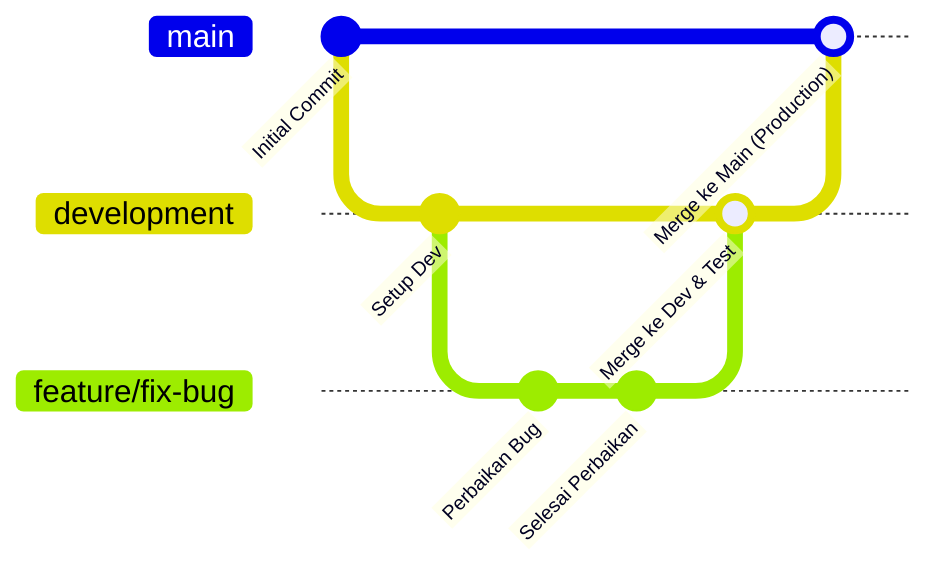

# Panduan Alur Kerja Git: Menggunakan Branch `development` untuk Testing

Dokumen ini menjelaskan langkah-langkah lengkap untuk memisahkan alur kerja perbaikan (bugfix) atau fitur baru menggunakan branch `development` sebelum digabungkan ke branch utama (`main`/`master`). Hal ini bertujuan agar kode yang masuk ke produksi sudah melalui proses uji coba (testing) terlebih dahulu.

---

## 📊 Ilustrasi Alur Kerja (Git Workflow)

Berikut adalah diagram alur kerja menggunakan branch `development` dan branch fitur/bugfix:



---

## 🛠️ Langkah-Langkah Lengkap

### Langkah 1: Membuat & Mendaftarkan Branch `development`

Jika Anda belum memiliki branch `development`, lakukan langkah awal ini sekali saja:

1. **Pastikan Anda berada di branch `main` dan sinkron dengan remote:**
   ```bash
   git checkout main
   git pull origin main
   ```

2. **Buat branch baru bernama `development` dari branch `main`:**
   ```bash
   git checkout -b development
   ```

3. **Push branch `development` baru tersebut ke server remote (GitHub/GitLab):**
   ```bash
   git push -u origin development
   ```

Sekarang, branch `development` telah siap digunakan sebagai basis pengembangan.

---

### Langkah 2: Membuat Perbaikan atau Fitur Baru

Saat ada perbaikan (*bugfix*) atau fitur baru yang perlu dikerjakan, **jangan langsung mengedit di branch `development` atau `main`**. Buatlah branch terpisah dari `development`:

1. **Pindah ke branch `development` dan tarik pembaruan terbaru:**
   ```bash
   git checkout development
   ```

2. **Buat branch baru untuk perbaikan/fitur Anda:**
   *Gunakan nama yang deskriptif, contoh: `fix/error-login` atau `feature/export-pdf`.*
   ```bash
   git checkout -b fix/error-login
   ```

3. **Lakukan perubahan kode (coding) seperti biasa.** Setelah selesai, commit perubahan Anda:
   ```bash
   git add .
   git commit -m "fix: menyelesaikan error login pada auth controller"
   ```

---

### Langkah 3: Melakukan Penggabungan (Merge) ke `development` untuk Uji Coba

Setelah perbaikan selesai dibuat di branch fitur/bugfix Anda, saatnya menggabungkannya ke `development` untuk dites:

1. **Pindah kembali ke branch `development`:**
   ```bash
   git checkout development
   ```

2. **Tarik update terbaru dari remote `development`** (menghindari konflik jika ada rekan tim lain yang melakukan merge):
   ```bash
   git pull origin development
   ```

3. **Gabungkan (merge) branch perbaikan Anda ke `development`:**
   ```bash
   git merge fix/error-login
   ```

4. **Kirim (push) pembaruan tersebut ke remote server:**
   ```bash
   git push origin development
   ```

> [!NOTE]  
> Pada tahap ini, Anda atau tim QA dapat melakukan testing di lingkungan lokal (local testing) atau lingkungan **Staging / QA** yang terhubung secara otomatis (CI/CD) ke branch `development`.

---

### Langkah 4: Menghapus Branch Perbaikan yang Sudah Selesai (Opsional)

Jika perbaikan sudah berhasil digabungkan ke `development`, Anda bisa menghapus branch lokal agar repository tetap bersih:
```bash
git branch -d fix/error-login
```

---

### Langkah 5: Menggabungkan ke Branch `main` (Setelah Lolos Testing)

Setelah perbaikan diuji di branch `development` dan dinyatakan stabil serta aman untuk dideploy ke produksi (production):

1. **Pindah ke branch `main`:**
   ```bash
   git checkout main
   ```

2. **Tarik update terbaru dari `main`:**
   ```bash
   git pull origin main
   ```

3. **Gabungkan branch `development` ke `main`:**
   ```bash
   git merge development
   ```

4. **Kirim pembaruan ke server produksi:**
   ```bash
   git push origin main
   ```

---

## 💡 Praktik Terbaik (Best Practices)

### 1. Proteksi Branch (`Branch Protection Rules`)
Untuk mencegah ketidaksengajaan melakukan push langsung ke `main` atau `development`:
* **GitHub**: Masuk ke **Settings** > **Branches** > **Add branch protection rule**.
* Masukkan `main` dan `development`, lalu centang opsi **Require a pull request before merging** dan **Require status checks to pass before merging**.

### 2. Gunakan Pull Request (PR) / Merge Request (MR)
Dibanding melakukan `git merge` manual di lokal seperti Langkah 3 dan 5, disarankan menggunakan Pull Request di GitHub/GitLab:
1. Push branch fitur Anda: `git push origin fix/error-login`
2. Buka GitHub/GitLab, buat Pull Request dari `fix/error-login` ke `development`.
3. Setelah lolos review dan testing, gabungkan PR tersebut.
4. Ketika ingin rilis ke produksi, buat Pull Request dari `development` ke `main`.
